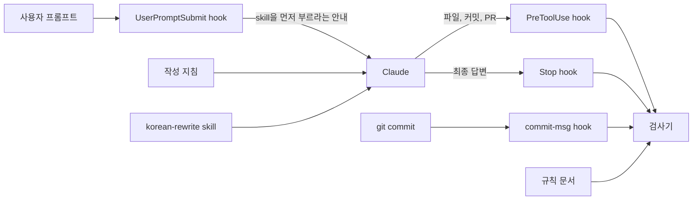

# im-a-korean-ai-in-seoul

Claude Code에서 Claude가 자연스러운 한국어를 쓰게 하는 도구입니다. 프로젝트에 설치하면 Claude는 답변, 문서, 주석, 커밋 메시지를 한국어로 쓰기 전에 `korean-rewrite` skill을 부릅니다. 다 쓴 글은 hook이 검사기로 확인합니다. 검사기가 오류를 찾으면 hook은 그 글이 파일, 커밋, PR에 남지 않게 막습니다. 그 글이 답변이면 Claude에게 한 번 다시 쓰게 합니다.

## 특징

- **영어식 표현을 피합니다.** skill은 Claude에게 요청을 읽을 때부터 한국어로 생각하라고 합니다. 영어로 떠올린 문장을 옮기면 영어 문장 구조가 남기 때문입니다. `설정하는 것이 가능합니다`, `서버로부터 응답을 받지 못했습니다`처럼 영어 구조를 따른 표현과 그 표현을 고친 예도 skill에 들어 있습니다.
- **요청한 것만 씁니다.** skill은 답부터 쓰라고 합니다. 머리말, 묻지 않은 제안, 요청에 없는 연도나 예시 코드는 붙이지 말라고 합니다. 공개하는 글에 개발 서버 주소 같은 내부 정보와 개인 정보를 넣지 말라는 지시도 있습니다.
- **말투를 하나로 맞춥니다.** 기본 말투는 `~합니다`로 끝나는 합니다체이고 설치할 때 해요체를 고를 수도 있습니다. 검사기는 고른 말투와 다른 어미 가운데 규칙 문서에 정해 둔 어미를 오류로 잡습니다. 잡지 못하는 어미는 [제약](docs/limits.md)에 있습니다.
- **Claude가 쓴 글에 오류가 있으면 파일, 커밋, PR에 남기 전에 막습니다.** Claude가 파일에 쓰거나 커밋하거나 PR을 올리기 직전에 hook이 그 글을 검사합니다. skill을 거치지 않았거나 검사기가 오류를 찾으면 hook이 막습니다. Claude는 hook이 알려 준 이유를 보고 문장을 고쳐 다시 씁니다.
- **문맥에 맞는 표현까지 막지는 않습니다.** 말투, emoji와 가운뎃점 같은 금지 문자, Claude Code 생성 표시처럼 프로젝트가 정책으로 정한 것만 오류로 막습니다. 생성 표시는 Claude Code가 커밋 메시지와 PR 설명 끝에 붙이는 `Co-Authored-By: Claude` 같은 줄입니다. 영어식 구절, 긴 문장, 쉼표는 문맥에 따라 맞을 수도 있으므로 경고로만 알립니다.
- **검사기는 모델을 부르지 않습니다.** 규칙 문서에 적힌 목록과 한도로 글을 검사하는 Node.js 프로그램이고 네트워크에도 접속하지 않습니다. 같은 글을 같은 규칙으로 검사하면 결과가 늘 같습니다.
- **팀이 같은 규칙을 씁니다.** 검사 규칙은 저장소에 커밋하는 Markdown 문서 하나에 있습니다. 팀원이 설치 명령을 한 번 실행하면 같은 규칙이 적용됩니다. 설치 스크립트는 Git 저장소에 `commit-msg` hook도 설치합니다. 이 hook은 사람이 직접 하는 커밋과 다른 agent로 하는 커밋의 메시지도 검사합니다.
- **근거를 밝힙니다.** skill의 원칙과 고칠 표현은 Claude가 실제로 쓴 문장, 국립국어원 자료, 회사들이 공개한 글쓰기 가이드, 소프트웨어 현지화 스타일 가이드, 법령과 기관 지침, 웹 보안 자료, 언어 모델 연구에서 가져왔습니다. 출처는 [한국어 작성 원칙](docs/writing.md)에 있습니다. 자료에 없는 규칙은 그 문서에 이 저장소가 정한 규칙이라고 적어 두었습니다.

## 설치 전후 비교

요청 열두 가지를 Claude Opus 5.5에 보냈습니다. 요청마다 이 도구를 설치한 프로젝트에서 두 번, 이 도구가 없는 프로젝트에서 두 번 보냈습니다. 요청을 보낼 때마다 새 세션을 열었습니다.

아래는 영어 README 문단을 한국어로 옮겨 달라는 요청과 두 프로젝트에서 받은 첫 번째 답변입니다. 요청 열두 가지 가운데 차이가 잘 드러나는 요청을 골랐습니다. 이 요청에 나오는 `allow`, `make sure`, `hook`은 skill 예문에도 나옵니다. 답변은 원문 문장에 맞춰 나눠 나란히 놓았고 글자는 바꾸지 않았습니다.

**요청**

<!-- korean-style-quote -->

> 다음 README 문단을 한국어로 옮겨 줘. 설명은 붙이지 마.
>
> This tool allows you to run the same checks locally that our CI runs. Make sure Docker is running before you start. Results are written to the reports directory, and a summary is printed once all checks have completed. If a check fails, the exit code is set to 1 so that it can be used in pre-commit hooks.

<!-- /korean-style-quote -->

**첫 번째 답변**

<!-- korean-style-quote -->

| 이 도구가 없는 프로젝트 | 이 도구를 설치한 프로젝트 |
| --- | --- |
| 이 도구를 사용하면 CI에서 실행하는 것과 동일한 검사를 로컬에서 실행할 수 있습니다. | 이 도구를 쓰면 CI에서 돌리는 검사를 로컬에서 똑같이 돌릴 수 있습니다. |
| 시작하기 전에 Docker가 실행 중인지 확인하세요. | 시작하기 전에 Docker가 실행 중인지 확인해 주십시오. |
| 결과는 reports 디렉터리에 저장되며, 모든 검사가 완료되면 요약이 출력됩니다. | 결과는 reports 디렉터리에 기록됩니다. 모든 검사가 끝나면 요약을 출력합니다. |
| 검사가 실패하면 종료 코드가 1로 설정되므로 pre-commit 훅에서 활용할 수 있습니다. | 검사가 하나라도 실패하면 종료 코드가 1이 되므로 pre-commit hook에서 쓸 수 있습니다. |

<!-- /korean-style-quote -->

이 도구가 없는 프로젝트에서 Claude는 두 번 모두 합니다체 문단에 해요체 `확인하세요`를 섞었고 hook을 소리 나는 대로 `훅`이라고 적었습니다. 원문의 `the same checks locally that our CI runs`와 `is set to 1`은 `실행하는 것과 동일한 검사`, `1로 설정되므로`처럼 영어 구조를 따라 옮겼습니다. 이 도구를 설치한 프로젝트에서 Claude는 두 번 모두 합니다체로만 썼습니다. 같은 두 구절은 영어 구조를 따르지 않고 `로컬에서 똑같이`, `1이 되므로`처럼 옮겼습니다. 다만 `Results are written`은 네 답변 모두 원문 수동태를 따라 옮겼습니다. 두 프로젝트의 두 번째 답변이 첫 번째 답변과 어떻게 다른지는 [설치 전후 예시](docs/examples.md#3-영어-readme-문단을-한국어로-옮기기)에 있습니다.

두 프로젝트에서 받은 답변을 검사기와 실행 기록으로 센 결과입니다. 두 프로젝트의 답변은 모두 합니다체를 쓰는 기본 규칙으로 검사했습니다. 그래서 말투를 섞지 않고 해요체로만 쓴 답변도 오류가 있는 답변으로 셌습니다.

| 항목 | 이 도구가 없는 프로젝트 | 이 도구를 설치한 프로젝트 |
| --- | --- | --- |
| skill을 거친 답변 | 24개 중 0개 | 24개 중 24개 |
| Stop hook이 다시 쓰게 한 답변 | 24개 중 0개 | 24개 중 0개 |
| 검사기가 오류를 찾은 답변 | 24개 중 17개 | 24개 중 0개 |
| 검사기가 해요체 어미를 찾은 답변 | 24개 중 17개 | 24개 중 0개 |
| emoji가 들어간 답변 | 24개 중 4개 | 24개 중 0개 |
| 가운뎃점이 들어간 답변 | 24개 중 2개 | 24개 중 0개 |
| Claude Code 생성 표시가 들어간 답변 | 24개 중 2개 | 24개 중 0개 |
| 답변 길이 합계 | 18,613자 | 10,082자 |
| 처음 보낸 요청에서 답변 하나에 든 평균 비용 | 0.042달러 | 0.123달러 |
| 같은 요청을 다시 보냈을 때 답변 하나에 든 평균 비용 | 0.017달러 | 0.038달러 |
| 답변 하나를 받는 데 걸린 평균 시간 | 12.2초 | 15.0초 |

이 도구를 설치한 프로젝트에서는 skill 본문이 모델 입력에 들어가고 Claude Code가 모델을 호출하는 횟수도 늘어 비용과 시간이 더 들었습니다. 비용은 Claude Code가 정가로 계산해 결과에 기록한 금액입니다. 같은 요청을 다시 보냈을 때는 API가 처음 요청 때 캐시에 저장해 둔 입력을 다시 읽어 비용이 줄었습니다.

검사기는 규칙 문서에 적힌 형태만 찾습니다. 그래서 다음 세 가지는 사람이 답변을 직접 읽고 셌습니다.

| 항목 | 이 도구가 없는 프로젝트 | 이 도구를 설치한 프로젝트 |
| --- | --- | --- |
| 머리말이 있는 답변 | 24개 중 8개 | 24개 중 2개 |
| 덧붙인 말이 있는 답변 | 24개 중 14개 | 24개 중 3개 |
| 요청에 없는 내용이 있는 답변 | 24개 중 15개 | 24개 중 1개 |

머리말은 요청한 글 앞에 붙여 답변 자체를 설명하는 문장입니다. 이 도구가 없는 프로젝트에서 Claude가 리뷰 코멘트 요청에 쓴 첫 번째 답변은 `실제 코드를 못 봐서 일반적인 형태로 썼어요.`로 시작했습니다. 덧붙인 말은 요청한 글 뒤에 붙인 제안, 질문, 설명입니다. 같은 답변은 `PR 코드를 붙여 주시면 실제 코드에 맞춰서 다시 다듬어 드릴게요.`로 끝났습니다. 요청에 없는 내용은 연도, 요일, 테스트 목록, 예시 코드처럼 사용자가 주지 않았는데 답변에 넣은 사실, 목록, 코드입니다. 점검 공지 요청에서는 이 도구가 없는 프로젝트의 첫 번째 답변에 `2027년 10월 24일(일)`이라는 점검 일시가 들어 있었습니다. 요청에는 연도와 요일이 없었습니다.

요청 열두 가지 가운데 위 번역 요청을 비롯한 다섯 가지에는 skill 예문과 같은 낱말이나 문장이 들어 있습니다. 검사기로 센 해요체 어미, 금지 문자, 생성 표시는 skill 예문이 다루는 문제가 아닙니다. skill 예문과 겹치지 않는 요청 일곱 가지만 따로 세어도 머리말, 덧붙인 말, 요청에 없는 내용은 이 도구를 설치한 프로젝트의 답변에서 더 적게 나왔습니다. 다만 어떤 낱말을 골랐는지는 skill 예문과 겹치는 요청과 겹치지 않는 요청으로 나눠 비교하지 못했습니다. 그래서 위 번역에서 `훅` 대신 `hook`을 쓴 것 같은 낱말 차이는 skill 예문 때문일 수 있습니다. 나눠 센 결과와 자세한 기준은 [설치 전후 예시](docs/examples.md#skill-예문과-겹치는-요청)에 있습니다.

이 도구는 기술 설명이 맞는지 확인하지 않습니다. 기술 설명이나 제품 화면 이름이 틀린 답변은 두 프로젝트에서 모두 나왔습니다.

두 프로젝트는 평가 스크립트가 임시 디렉터리에 새로 만들었습니다. 두 프로젝트에서 모두 Claude가 쓸 수 있는 도구는 Skill, Read, Bash뿐이었습니다. Claude Code 2.1.310에서 effort를 medium으로 두고 2026년 10월 27일(한국 시간)에 실행했습니다. 요청 원문은 [showcase.json](test/fixtures/eval/showcase.json)에 있습니다. 요청마다 받은 답변은 [설치 전후 예시](docs/examples.md)에 있습니다.

검사기와 실행 기록으로 센 표의 숫자는 이 실행에서 저장한 결과를 `npm run eval -- --summary`로 센 값입니다. 실행 결과는 저장소에 넣지 않습니다. [다시 실행하기](docs/examples.md#다시-실행하기)의 명령으로 같은 비교를 다시 할 수 있습니다. 다만 답변이 실행할 때마다 달라지므로 숫자도 달라질 수 있습니다.

## 설치

Node.js 20 이상과 npm, Git, Claude Code가 필요합니다. 명령은 macOS, Linux, WSL의 shell에서 실행합니다. Git을 쓰는 새 프로젝트라면 먼저 `git init`을 실행합니다. 프로젝트 루트에 `.git`이 없으면 설치 스크립트는 `.gitignore` 항목과 `commit-msg` hook을 추가하지 않습니다.

Claude Code에서 이렇게 요청하면 Claude가 저장소를 읽고 설치합니다.

> https://github.com/nerdkim/im-a-korean-ai-in-seoul 저장소를 읽고 이 프로젝트에 설치해 주십시오.

직접 설치하려면 프로젝트 루트에서 다음 명령을 실행합니다.

```sh
npx -y github:nerdkim/im-a-korean-ai-in-seoul --target . --activate
node .korean-style/scripts/doctor.mjs
```

설치한 뒤에는 Claude Code를 다시 시작합니다. 이 도구는 다른 npm 패키지를 쓰지 않습니다.

말투는 `--register 해요체`처럼 고릅니다. 처음 설치할 때 이 옵션을 주지 않으면 합니다체를 씁니다. 다른 설치 방법과 옵션, 팀에서 쓰는 법, 제거하는 법은 [설치와 사용](docs/usage.md)에 있습니다.

### 설치하면 바뀌는 것

설치 스크립트는 프로젝트 설정(`.claude/settings.json`)에 hook 세 개를 추가합니다. 프로젝트에서 고른 output-style이 없으면 작성 지침인 `korean-style`을 고릅니다. 위 명령처럼 `--activate`를 붙이면 이미 다른 output-style을 골라 두었어도 `korean-style`로 바꿉니다.

설치 스크립트는 `attribution`의 `commit`과 `pr`에 값이 없으면 빈 값을 넣습니다. 그러면 Claude Code가 커밋과 PR에 생성 표시를 붙이지 않습니다.

Claude Code 2.1.310을 기본 설정으로 쓰면 Anthropic 서버는 Claude가 도구를 부르는 사이에 쓴 진행 보고 가운데 일부를 요약한 문장으로 바꿔 보냅니다. Claude Code는 이 문장을 화면에 보여 줍니다. 이 문장은 Claude가 쓴 글이 아니어서 skill과 hook을 거치지 않습니다. 그래서 설치 스크립트는 `env`에 `CLAUDE_CODE_THINKING_DISPLAY_UPDATES` 값이 없으면 `0`을 넣어 이 문장이 화면에 나오지 않게 합니다. 요약한 문장 대신 Claude가 쓴 원래 진행 보고가 나오지는 않습니다.

설치 스크립트는 `attribution`과 `env`에 프로젝트가 이미 정해 둔 값을 바꾸지 않습니다.

Git 저장소에는 `commit-msg` hook도 설치합니다. 다른 `commit-msg` hook이 이미 있으면 설치 스크립트는 그 hook을 덮어쓰지 않습니다. 이때 사람이 직접 하는 커밋과 다른 프로그램으로 하는 커밋도 검사하려면 기존 hook에 검사기를 실행하는 줄을 넣어야 합니다. 방법은 [설치와 사용](docs/usage.md)에 있습니다.

## 동작 원리

이 도구는 Claude가 한국어를 쓰기 전에는 기준을 주고 쓴 뒤에는 검사합니다.



### 쓰기 전

Claude Code는 세션을 시작할 때 작성 지침을 시스템 프롬프트에 넣습니다. 작성 지침은 말투와 기본 원칙을 정한 `korean-style` output-style입니다.
사용자가 프롬프트를 보낼 때마다 UserPromptSubmit hook은 한국어를 쓰기 전에 `korean-rewrite` skill을 부르라고 Claude에게 알립니다. skill은 Claude에게 독자와 쓸 내용부터 정하게 합니다. 그다음 한국어 어순대로 쓰고 고칠 표현을 찾아 고친 뒤 다 쓴 문장을 영어로 되옮겨 보게 합니다.

### 쓴 뒤

Claude가 파일에 쓰거나 `git commit`, `gh pr`, `gh issue`를 실행하기 직전에 PreToolUse hook이 쓸 글을 검사기로 확인합니다. skill을 부르지 않았거나 검사기가 오류를 찾으면 hook은 도구 실행을 막고 skill을 부르라는 안내나 위반 목록을 Claude에게 돌려줍니다.
Claude가 답변을 마치면 Stop hook이 최종 답변을 검사합니다. skill을 부르지 않았거나 검사기가 오류를 찾으면 Stop hook은 Claude에게 답변을 한 번 다시 쓰게 합니다. 답변은 이미 화면에 나왔으므로 막지는 못합니다.
Git이 커밋할 때는 `commit-msg` hook이 메시지를 검사하고 오류가 있으면 커밋을 멈춥니다. 이 hook은 사람이 터미널에서 직접 하는 커밋과 다른 agent로 하는 커밋에서도 실행됩니다.

hook이 언제 무엇을 검사하는지와 skill을 요구하지 않는 경우는 [동작 원리](docs/how-it-works.md)에 있습니다.

## 구조

설치 스크립트는 이 저장소의 파일을 프로젝트에 복사하고 프로젝트 설정에 hook을 등록합니다.

| 구성 요소 | 내용 | 이 저장소의 경로 | 설치한 프로젝트의 경로 |
| --- | --- | --- | --- |
| `korean-rewrite` skill | 한국어를 쓰는 순서와 고칠 표현 | `skill/korean-rewrite/` | `.claude/skills/korean-rewrite/` |
| `korean-style` skill | 검사 규칙을 확인하고 어색한 표현의 원인을 찾는 방법 | `skill/korean-style/` | `.claude/skills/korean-style/` |
| 작성 지침 | 말투와 기본 원칙 | `output-styles/korean-style.md` | `.claude/output-styles/korean-style.md` |
| 규칙 문서 | 검사할 표현과 규칙마다 정한 등급 | `docs/rules.md` | `.korean-style/rules.md` |
| 검사기 | 규칙 문서대로 글을 검사하는 프로그램 | `scripts/check-korean.mjs`, `scripts/lib/` | `.korean-style/scripts/` |
| Claude Code hook | 프롬프트를 보낼 때 안내하고 도구 실행 직전과 답변을 마칠 때 검사하는 스크립트 | `scripts/hooks/` | `.korean-style/scripts/hooks/`, `.claude/settings.json` |
| Git hook | 커밋 메시지를 검사하는 스크립트 | `scripts/hooks/commit-msg.mjs` | `.korean-style/scripts/hooks/commit-msg.mjs`, `.git/hooks/commit-msg` |
| doctor | 설치 상태를 확인하는 스크립트 | `scripts/doctor.mjs` | `.korean-style/scripts/doctor.mjs` |

`.git/hooks/commit-msg`는 `.korean-style/scripts/hooks/commit-msg.mjs`를 실행하는 작은 Node.js 파일입니다.

규칙 문서와 프로젝트 설정처럼 팀이 함께 쓸 파일은 저장소에 커밋합니다. 설치 스크립트는 검사기, hook 스크립트, skill, 작성 지침을 `.gitignore`에 넣고 설치할 때마다 새로 만듭니다. 그래서 저장소를 clone한 팀원도 설치 명령을 한 번 실행해야 합니다.

검사기는 먼저 문서에서 인용 표시로 감싼 구간을 빼고 이어서 코드 블록과 인라인 코드를 뺍니다. 그다음 글을 문장으로 나눠 `scripts/lib/rules/`의 규칙 모듈 여덟 개를 차례로 실행합니다. 코드 블록 안은 따로 꺼내 말투와 금지 문자 같은 일부 규칙으로만 검사합니다.

| 모듈 | 보는 것 | 기본 등급 |
| --- | --- | --- |
| `chars.mjs` | 가운뎃점, 줄표, emoji, 한자 같은 금지 문자 | 오류 |
| `register.mjs` | 고른 말투와 다른 어미, 사람에게 내리는 명령, 금지 호칭, 질문이나 지적을 칭찬하는 말 | 오류 |
| `punctuation.mjs` | 쉼표 수와 연결 어미 뒤 쉼표 | 경고 |
| `structure.mjs` | 이중피동, 긴 문장, 명사형 종결과 `~의` 빈도 | 이중피동은 오류, 나머지는 경고 |
| `translationese.mjs` | 영어식 구절, 영어 동사를 직역한 동사 | 경고 |
| `vocabulary.mjs` | 외래어 표기, 오타, 영어를 낱말 단위로 옮겨 만든 말 | 오류 |
| `density.mjs` | 굵은 글씨와 대조 구문이 나오는 빈도 | 경고 |
| `attribution.mjs` | Claude Code 생성 표시 | 오류 |

모듈마다 보는 것과 팀이 값을 채워야 켜지는 검사는 [동작 원리](docs/how-it-works.md#규칙-모듈)에 모두 있습니다.

회귀 테스트는 `test/`에 있고 실제 모델로 하는 평가의 입력은 `test/fixtures/eval/`에 있습니다.

## 쓰는 법

설치하고 Claude Code를 다시 시작하면 따로 할 일은 없습니다. skill을 직접 부르려면 메시지 맨 앞에 `/`와 skill 이름을 입력합니다.

| skill | 쓸 때 | 예 |
| --- | --- | --- |
| `korean-rewrite` | 한국어 글을 쓰거나 다듬을 때, 영어 문서를 한국어로 옮길 때 | `/korean-rewrite docs/guide.md를 자연스러운 한국어로 다듬어 주십시오` |
| `korean-style` | 검사 규칙을 확인하거나 표현이 어색한 이유를 찾을 때 | `/korean-style README.md에서 어색한 표현을 찾아 주십시오` |

검사기는 Claude 없이 직접 실행할 수도 있습니다. 오류가 있으면 종료 코드 1로 끝나고 경고만 있으면 0으로 끝납니다. 검사기는 파일을 고치지 않습니다.

```sh
node .korean-style/scripts/check-korean.mjs --file docs/guide.md
node .korean-style/scripts/check-korean.mjs --all
node .korean-style/scripts/check-korean.mjs --explain translationese
```

규칙을 바꾸려면 `.korean-style/rules.md`의 `korean-style-rules` 블록을 고칩니다. 막지 않고 경고만 할 규칙은 `advisory-rules`에 넣습니다. 영어를 낱말 단위로 옮겨 만든 말은 `calques`에, `훅` 같은 한글 음차는 `banned-transliteration`에 대신 쓸 말과 함께 적습니다. hook은 실행될 때마다 규칙 문서를 새로 읽으므로 Claude Code를 다시 시작하지 않아도 됩니다. 직접 고친 규칙은 다시 설치해도 그대로 남습니다.

Codex와 Gemini CLI에서는 skill, 작성 지침, Claude Code hook이 동작하지 않습니다. Git `commit-msg` hook은 어느 프로그램으로 커밋하든 실행되므로 커밋 메시지는 검사합니다. 다른 agent도 같은 기준을 따르게 하려면 `AGENTS.md`나 `GEMINI.md`에 지시를 적어 둡니다. 한국어를 쓰기 전에 `.claude/skills/korean-rewrite/SKILL.md`를 읽고 그 순서를 따르라고 적습니다.

## 제약

- hook은 Claude가 skill을 불렀는지만 확인하고 skill에 적힌 순서를 모두 따랐는지는 확인하지 않습니다. 이 도구는 Claude가 실제로 어떤 언어로 생각했는지도 확인하지 못합니다.
- 검사기는 규칙 문서에 적힌 형태만 찾습니다. 서술어 하나에 정보를 몰아넣은 문장과 무엇을 가리키는지 흐린 지시어는 잡지 못합니다. 영어 문장을 낱말 단위로 옮긴 문장, 요청에 없는 내용, 공개하면 안 되는 정보도 잡지 못합니다.
- Stop hook은 답변이 화면에 나온 뒤에 실행되므로 다시 쓰기 전의 답변도 화면에 남습니다. 다시 쓴 답변과 Claude가 도구를 부르는 사이에 쓴 진행 보고는 어느 hook도 검사하지 않습니다.
- 기본 규칙에서는 한글이 20자보다 적은 글에 skill을 요구하지 않습니다. hook은 같은 요청에서 skill을 부르지 않았다는 이유로 두 번 막았는데도 Claude가 skill을 부르지 않으면 그 뒤로는 이 이유로 막지 않습니다.
- hook은 shell 명령으로 실행한 프로그램이 직접 쓰는 파일과 `--body-file`로 넘긴 PR 본문을 검사하지 않습니다. 사람이 편집기로 고친 파일도 Claude Code hook이 검사하지 않습니다.

나머지 제약은 [제약](docs/limits.md)에 있습니다.

## 문서

| 문서 | 내용 |
| --- | --- |
| [설치와 사용](docs/usage.md) | 설치 옵션, 설치되는 파일, 규칙 바꾸는 법, 팀에서 쓰는 법, 제거하는 법, 문제 해결 |
| [동작 원리](docs/how-it-works.md) | hook이 언제 무엇을 검사하고 막는지, 검사기가 글을 처리하는 순서 |
| [검사 규칙](docs/rules.md) | 규칙 목록과 규칙을 오류와 경고로 나눈 근거 |
| [한국어 작성 원칙](docs/writing.md) | skill이 따르는 원칙과 출처 |
| [제약](docs/limits.md) | 이 도구가 하지 못하는 것 |
| [설치 전후 예시](docs/examples.md) | 열두 가지 요청마다 두 프로젝트에서 받은 답변과 그 차이 |

이 저장소를 고칠 때는 `CLAUDE.md`를 따르고 커밋하기 전에 `npm run gate`로 검사와 테스트를 실행합니다.

## 라이선스

[MIT](LICENSE)
