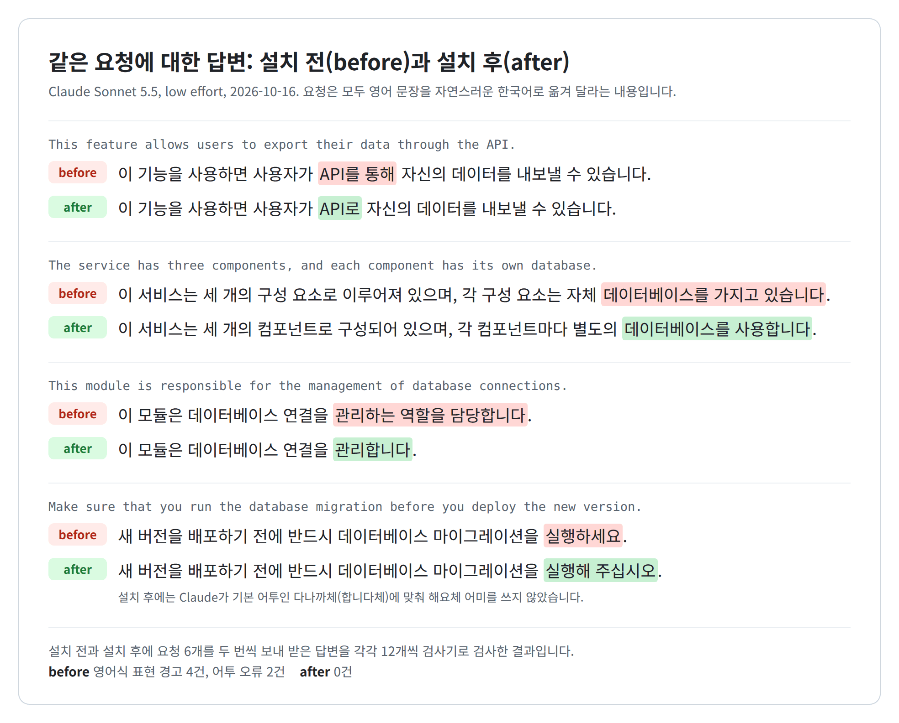

# im-a-korean-ai-in-seoul

Claude Code가 쓰는 한국어를 바로잡는 도구입니다.

Claude에게 한국어로 글을 맡기면 Chrome 화면에 나오는 `확장 프로그램` 대신 extension을 `확장`으로 옮기는 식의 직역, 합니다체와 해요체가 섞인 문장, 묻지 않은 조언과 emoji가 자주 나옵니다. 이 도구를 프로젝트에 설치하면 Claude는 한국어를 쓰는 turn마다 먼저 `korean-rewrite` skill을 부르고, 그 절차에 따라 답변과 문서, 주석, 커밋 메시지를 다듬어 씁니다. Claude가 skill을 건너뛰면 hook이 한국어 파일 쓰기와 커밋을 막고, 답변은 skill을 거쳐 다시 쓰게 합니다.

## 설치 전후



위 그림에는 장애 내용을 주고 팀 슬랙에 올릴 요약을 써 달라고 했을 때 Claude가 쓴 답변을 그대로 실었습니다. 왼쪽은 이 도구가 없는 빈 프로젝트에서, 오른쪽은 이 도구를 설치한 프로젝트에서 받았습니다. 왼쪽 답변에서 Claude는 붙여넣는 방법을 안내하는 해요체 머리말로 시작해 emoji 코드를 넣었고, 끝에는 묻지 않은 조언을 덧붙였습니다. 오른쪽 답변에서는 원문 내용만 합니다체로 썼습니다.

두 프로젝트에서 요청 여섯 가지를 두 번씩 보냈습니다. skill이 없는 쪽은 답변 12개 가운데 10개에서 검사기 오류가 나왔습니다. PR 설명에는 Claude가 두 번 모두 메모에 없는 테스트 목록을 지어 넣었습니다. Chrome 질문에는 두 번 모두 `확장 카드`처럼 줄여 쓴 용어가 나왔습니다. 설치한 쪽에서는 Claude가 12번 모두 skill을 불렀고, 검사기 오류가 나온 답변은 없었습니다. Stop hook이 다시 쓰라고 요구한 적도 없습니다.

요청은 `test/fixtures/eval/showcase.json`에 있습니다. 2026-10-17에 Claude Code 2.1.302에서 Claude Opus 5.5에 medium effort로 보냈습니다. 그림에 실은 답변은 장애 공유 요청을 처음 보냈을 때 받은 것입니다. 같은 비교를 다시 하는 방법은 [개발](#개발)에 있습니다.

## 설치

이 도구를 쓸 프로젝트에서 Claude Code를 열고 이렇게 요청하면 됩니다.

> https://github.com/nerdkim/im-a-korean-ai-in-seoul 저장소를 읽고 이 프로젝트에 설치해 주십시오.

Claude는 아래 명령으로 설치합니다. 프로젝트 루트에서 직접 실행해도 됩니다.

```sh
npx -y github:nerdkim/im-a-korean-ai-in-seoul --target . --activate
node .korean-style/scripts/doctor.mjs
```

설치가 끝나면 Claude Code를 다시 시작합니다. skill과 hook은 새 세션부터 적용됩니다.

Node.js 20 이상(npm 포함), Git, Claude Code와 shell 환경(macOS, Linux 또는 WSL)이 필요합니다. npm 패키지 의존성은 없습니다.
npx를 쓸 수 없으면 저장소를 내려받아 설치 스크립트를 직접 실행합니다.

```sh
git clone --depth 1 https://github.com/nerdkim/im-a-korean-ai-in-seoul.git /tmp/im-a-korean-ai-in-seoul
node /tmp/im-a-korean-ai-in-seoul/scripts/install.mjs --target "$PWD" --activate
```

새 프로젝트라면 디렉터리를 만들고 그 안에서 실행합니다. Git을 쓴다면 설치하기 전에 `git init`을 실행합니다.

### 설치 옵션

| 옵션 | 설명 |
| --- | --- |
| `--target <경로>` | 이 도구를 설치할 프로젝트의 루트입니다. 반드시 지정합니다. |
| `--activate` | 프로젝트의 output-style을 `korean-style`로 지정합니다. 생략하면 다른 output-style이 선택되어 있을 때는 그 설정을 유지하고, 선택된 것이 없을 때만 `korean-style`로 지정합니다. |
| `--register <어투>` | skill과 작성 지침, 어투 검사에 쓸 어투입니다. `다나까체`(합니다체, 기본값), `해요체`, `혼용` 가운데 하나를 고릅니다. `혼용`이면 검사기는 두 어투를 모두 허용하고, skill과 작성 지침은 한 답변 안에서 어투를 하나로 맞추라고 지시합니다. |
| `--dry-run` | 파일을 쓰지 않고 규칙 갱신 여부, 어투, 커밋 hook 경로 같은 설치 결과만 미리 보여 줍니다. |
| `--force` | 직접 수정한 규칙을 새 기본값으로 교체합니다. 교체하기 전에 백업합니다. |

답변과 문서, 주석, 커밋 메시지의 어투를 해요체로 맞추려면 설치 명령에 `--register 해요체`를 붙여 실행합니다.

설치 스크립트는 기존 `CLAUDE.md`, 다른 hook, 권한, MCP 설정, 다른 output-style 파일을 그대로 둡니다.
`.claude/settings.json`에는 hook 세 개를 더하고 필요할 때만 `outputStyle`을 바꿉니다. 사용자 전역 설정과 `.claude/settings.local.json`은 바꾸지 않습니다.
설정 파일이 손상되었거나 설치 경로에 symlink가 있으면 덮어쓰지 않고 멈춥니다. 처음 설치할 때 skill이나 output-style을 놓을 경로에 파일이 이미 있어도 멈춥니다.

## 설치하면 바뀌는 것

| 구성 요소 | 하는 일 |
| --- | --- |
| `korean-rewrite` skill | Claude가 한국어를 쓰기 전에 따르는 절차입니다. 영어를 낱말 단위로 옮긴 표현, 메모처럼 끊은 문장, 묻지 않은 제안 같은 습관을 실제 예시로 짚고, 그런 글을 고쳐 쓰게 합니다. |
| UserPromptSubmit hook | 사용자가 프롬프트를 보낼 때마다 이 skill을 먼저 부르라고 Claude에게 알립니다. |
| PreToolUse hook | skill을 부르지 않은 채 한국어 파일을 쓰거나 커밋하려 하면 막습니다. 금지 문자나 다른 어투가 섞인 파일 쓰기와 커밋도 막습니다. |
| Stop hook | skill을 거치지 않았거나 오류가 있는 한국어 답변을 한 번 다시 쓰게 합니다. |
| 작성 지침(output-style) | Claude Code가 system prompt에 넣는 어투와 기본 원칙입니다. |
| `commit-msg` Git hook | 어떤 프로그램으로 커밋하든 커밋 메시지를 검사합니다. |
| `korean-style` skill | 검사 규칙을 확인하거나 바꿀 때 씁니다. |

기술 용어를 영어로 써도 검사기는 막지 않습니다. 기본 규칙에서 오류로 막는 것은 정한 어투와 다른 어미, 산문에 쓴 middle dot과 em dash와 emoji 같은 금지 문자, 틀린 외래어 표기, 오타 등입니다. 영어식 표현과 긴 문장은 경고만 합니다. 규칙의 전체 목록은 [검사 규칙](docs/rules.md)에 있습니다.

### 설치되는 파일

| 경로 | 내용 | Git |
| --- | --- | --- |
| `.korean-style/rules.md` | 이 프로젝트의 검사 규칙 | 커밋 |
| `.korean-style/defaults.sha256` | 기본 규칙을 수정했는지 판별하는 값 | 커밋 |
| `.korean-style/scripts/` | 검사기, hook, doctor | 제외 |
| `.korean-style/docs/` | 기본 규칙 사본과 제약 문서 | 제외 |
| `.claude/skills/korean-rewrite/SKILL.md` | 한국어 작성 skill | 제외 |
| `.claude/skills/korean-style/SKILL.md` | 검사 규칙 skill | 제외 |
| `.claude/output-styles/korean-style.md` | 작성 지침 | 제외 |
| `.claude/settings.json` | hook 세 개와 `outputStyle` 설정 | 커밋 |
| `.gitignore` | 위에서 제외로 표시한 항목 | 커밋 |
| `.git/hooks/commit-msg` | 커밋 메시지 검사 | 해당 없음 |

제외로 표시한 파일은 Git에 올리지 않고 설치할 때마다 새로 만듭니다. 그래서 저장소를 clone한 팀원도 설치 명령을 한 번 실행해야 합니다.

## 사용법

설치한 뒤에는 따로 할 일이 없습니다. Claude가 한국어를 쓸 때마다 skill을 부르고, hook이 그 결과를 검사합니다.
skill을 직접 부르려면 메시지 맨 앞에 `/`와 skill 이름을 입력합니다.

| skill | 용도 | 예 |
| --- | --- | --- |
| `korean-rewrite` | 한국어 글을 쓰거나 다듬고, 영어 문서를 한국어로 옮깁니다 | `/korean-rewrite docs/guide.md를 자연스러운 한국어로 다듬어 주십시오` |
| `korean-style` | 검사 규칙을 확인하거나 어색한 표현을 진단합니다 | `/korean-style README.md에서 어색한 표현을 찾아 주십시오` |

### hook이 하는 일

| 시점 | 보는 것 | 하는 일 |
| --- | --- | --- |
| 사용자가 프롬프트를 보낼 때 | 없음 | skill을 먼저 부르라고 Claude에게 알립니다 |
| Claude Code가 도구를 실행하기 직전 | 파일에 쓸 내용(Write, Edit 등), 사용자에게 묻는 질문, 승인받을 계획, subagent 프롬프트, Bash로 실행하는 `git commit`의 메시지 | 오류가 있거나 skill을 부르지 않은 채 한국어를 쓰면 실행을 막고 이유를 알려 줍니다 |
| Claude Code가 답변을 마칠 때 | 이번 turn의 최종 답변 | skill을 거치지 않았거나 오류가 있으면 한 번 다시 쓰게 합니다 |
| Git이 커밋할 때(`commit-msg` hook) | 커밋 메시지 | 오류가 있으면 커밋을 멈춥니다 |

subagent 프롬프트는 영어로 써도 되므로 hook은 skill을 요구하지 않고 오류만 봅니다. 한글이 20자보다 적은 짧은 글에도 skill을 요구하지 않습니다. 이 기준은 규칙 문서의 `writing-skill-min-hangul`로 바꿉니다.
파일 쓰기에 오류는 없고 영어식 표현 같은 경고만 있으면 쓰기를 막지 않습니다. 다만 `review-rules`에 든 규칙의 경고가 이번에 바꾼 문단에서 새로 생겼다면 hook이 그 경고를 Claude에게 알립니다.
Claude가 shell 명령으로 검사 대상 파일에 직접 쓰면 그 내용은 검사를 거치지 않습니다. 그래서 hook은 이런 명령을 감지하면 막고 Write나 Edit 도구로 다시 쓰라고 안내합니다.
Stop hook은 답변이 화면에 표시된 뒤에 검사하므로 이미 표시된 답변은 되돌리지 못합니다. hook 실행 중에 예외가 발생하면 작업을 막지 않고 통과시킵니다.
skill을 요구하는 조건과 예외는 [검사 규칙](docs/rules.md#한국어를-쓰기-전에-부르는-skill)에, 내부 동작은 [동작 원리](docs/how-it-works.md)에 있습니다.

### 검사기 CLI

```sh
node .korean-style/scripts/check-korean.mjs --text '확인했습니다.'
node .korean-style/scripts/check-korean.mjs --file docs/guide.md
node .korean-style/scripts/check-korean.mjs --all
node .korean-style/scripts/check-korean.mjs --explain translationese
```

`--stdin`으로 표준 입력을 검사할 수 있고, `--target chat|doc|comment|commit`으로 글의 종류를 지정할 수 있습니다. 설치 스크립트의 `--target <경로>`와는 다른 옵션입니다.
오류가 있으면 종료 코드는 1이고, 사용법이 틀리면 2입니다. 경고만 있으면 0이며 `--strict`를 주면 1입니다.
검사기는 파일을 자동으로 고치지 않습니다. 기존 문서에 오류가 있어도 설치가 실패한 것은 아닙니다.

## 규칙 바꾸기

`.korean-style/rules.md`의 `korean-style-rules` 블록을 고칩니다. 차단하지 않고 경고만 할 규칙은 `advisory-rules`에 넣습니다. skill을 요구하지 않으려면 `writing-skill`을 비웁니다.
각 키의 뜻은 [검사 규칙](docs/rules.md)에 있습니다.
규칙을 고친 뒤에는 잡아야 할 문장과 통과해야 할 문장을 `--text`로 함께 확인합니다.

## 갱신과 팀 공유

같은 설치 명령을 다시 실행하면 검사기와 skill, 작성 지침을 최신으로 바꿉니다. hook을 중복으로 추가하지 않으며, `--register`를 주지 않으면 기존 어투를 유지합니다.
규칙을 수정하지 않았다면 새 기본값을 적용합니다. 직접 수정한 규칙은 그대로 두고, 수정했는지 판별할 수 없는 구버전 규칙도 그대로 둡니다.
새 기본값으로 바꾸려면 `--force`를 추가합니다. 기존 규칙은 `.korean-style/rules.backup-*.md`에 백업하므로 필요한 내용을 옮겨 올 수 있습니다.

Git worktree와 `core.hooksPath`를 지원합니다. 여러 checkout이 함께 쓰는 커밋 hook도 커밋하는 checkout의 규칙을 따릅니다.
이미 다른 `commit-msg` hook이 있으면 덮어쓰지 않습니다. 함께 쓰려면 기존 hook에서 다음 명령을 호출합니다.

```sh
node .korean-style/scripts/hooks/commit-msg.mjs "$1" || exit $?
```

Git 없이 설치해도 Claude Code hook은 동작합니다. 나중에 `git init`을 실행하고 다시 설치하면 `.gitignore` 항목과 커밋 hook을 추가합니다.

## 제거

1. `.korean-style/`, `.claude/skills/korean-style/`, `.claude/skills/korean-rewrite/`, `.claude/output-styles/korean-style.md`를 지웁니다.
2. `.claude/settings.json`에서 명령에 `.korean-style/scripts/hooks/`가 들어간 hook 항목과 `"outputStyle": "korean-style"`을 지웁니다.
3. `.gitignore`에서 `# korean-style`로 시작하는 줄과 이 도구가 추가한 여섯 줄(`.korean-style/*`, `!.korean-style/rules.md`, `!.korean-style/defaults.sha256`, `.claude/skills/korean-style/`, `.claude/skills/korean-rewrite/`, `.claude/output-styles/korean-style.md`)을 지웁니다.
4. `git rev-parse --git-path hooks/commit-msg`가 가리키는 파일에 `korean-style commit hook`이 들어 있는 줄이 있으면 그 파일을 지웁니다. 기존 hook에 검사기 호출을 직접 추가했다면 그 줄도 지웁니다.

## 문제 해결

먼저 `node .korean-style/scripts/doctor.mjs`로 설치 상태를 확인합니다. 실패 항목이 있으면 종료 코드 1로 끝납니다.

- **skill이나 hook이 적용되지 않을 때:** Claude Code를 다시 시작했는지 확인합니다. 그다음 `.claude/settings.local.json`의 `outputStyle`과 `disableAllHooks`를 확인합니다. worktree에서는 main worktree의 로컬 설정도 확인합니다. 적용 순서는 Claude Code의 [설정 우선순위](https://code.claude.com/docs/en/settings#settings-precedence)를 따릅니다.
- **조직 정책, 세션 옵션, 사용자 전역 설정을 확인할 때:** `doctor`는 프로젝트와 로컬 설정 파일만 읽습니다. Claude Code의 `/status`에서 실제 설정 출처를 확인합니다.
- **주의 항목이 나올 때:** 다른 커밋 hook을 쓰거나 커밋해야 할 파일이 Git에서 제외되어 있으면 `doctor`가 주의 항목으로 표시합니다.
- **설치가 멈출 때:** 손상된 설정 파일을 고치고, 같은 이름의 기존 파일이나 설치 경로의 symlink를 옮기거나 지운 뒤 다시 설치합니다.

## 다른 코딩 agent

skill과 hook, 작성 지침은 Claude Code에서만 동작합니다. Codex나 Gemini CLI에서는 적용되지 않습니다.
커밋 메시지 검사는 Git hook으로 동작하므로 어떤 프로그램으로 커밋해도 적용됩니다.
같은 기준을 따르게 하려면 한국어를 쓰기 전에 `.claude/skills/korean-rewrite/SKILL.md`를 읽고 그 절차를 따르라는 지시를 `AGENTS.md`나 `GEMINI.md`에 적습니다.

## 개발

이 저장소를 고칠 때는 `CLAUDE.md`를 따릅니다. `AGENTS.md`와 `GEMINI.md`는 `CLAUDE.md`를 가리키는 symlink입니다.
한국어 산문을 바꾸면 커밋하기 전에 `korean-reviewer` agent(`.claude/agents/korean-reviewer.md`)로 diff와 커밋 메시지를 검토합니다.

```sh
npm run gate                    # 자체 검사, 회귀 테스트, 문체 검사
npm run doctor                  # 이 저장소의 설정 확인
npm run eval -- --run           # 설치 전후 답변 비교, 유료 API 호출
```

일반 테스트는 API를 호출하지 않습니다. 평가 스크립트는 기본적으로 임시 프로젝트에서 `low` effort로 요청을 묶어 보냅니다.
`--individual`을 주면 요청마다 새 세션을 씁니다. `--with-hooks`를 주면 두 임시 프로젝트 가운데 한쪽에만 이 도구를 설치해 hook과 skill이 실제로 동작하게 하고, 응답마다 Claude가 부른 skill을 기록합니다. 이때 두 프로젝트 모두에서 Claude가 Skill 도구를 쓰고 검사기를 실행할 수 있게 합니다.
위의 설치 전후 비교는 아래 명령으로 다시 할 수 있습니다. 유료 API를 호출하며, 답변은 `.eval/latest/results.json`에 저장됩니다.

```bash
npm run eval -- --run --cases test/fixtures/eval/showcase.json --models claude-opus-5-5 --effort medium --repeat 2 --individual --with-hooks
```

`--cases test/fixtures/eval/regression.json`처럼 입력을 고를 수 있습니다. `calque.json`은 한국어로 옮기면 영어식 표현이 나오기 쉬운 영어 문장을 모은 입력이고, `showcase.json`은 위의 설치 전후 비교에 쓴 요청 여섯 가지입니다. 평가 스크립트는 사례마다 `mustNot`에 적은 표현이 응답에 나오면 제약 위반으로 셉니다.
다시 실행할 때는 `--out .eval/run2`처럼 새 경로를 지정합니다. [평가 입력](test/fixtures/eval/)만 Git에 두고 실행 결과는 커밋하지 않습니다.
원문과 응답은 함께 놓고 검토합니다.

[korean-rewrite skill](skill/korean-rewrite/SKILL.md), [작성 지침](output-styles/korean-style.md), [검사 규칙](docs/rules.md), [동작 원리](docs/how-it-works.md), [제약](docs/limits.md)에 세부 내용이 있습니다.

## 라이선스

[MIT](LICENSE)
