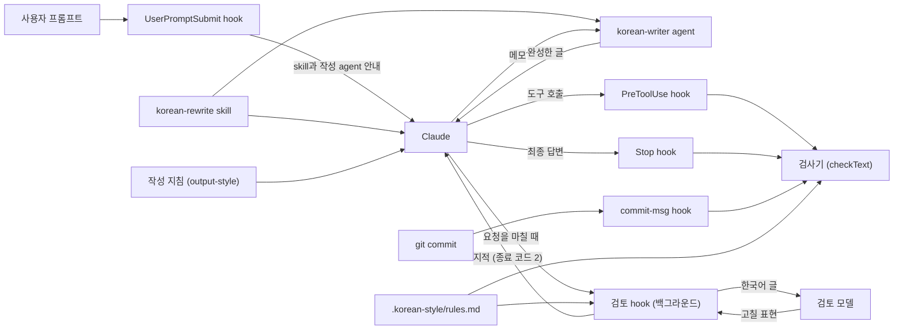

# 동작 원리

README와 [설치와 사용](usage.md)에서 다루지 않는 내부 동작을 설명합니다.

Claude는 한국어를 쓰기 전에 `korean-rewrite` skill을 부릅니다. skill에는 처음부터 한국어로 생각해 쓰는 순서가 들어 있습니다. Claude가 글을 쓴 뒤에는 검사기가 그 글을 프로젝트 규칙과 대조합니다. hook은 skill을 거치지 않았거나 검사기가 오류를 찾은 글이 파일, 커밋, PR에 남지 않게 막고 이런 글이 답변이면 한 번 다시 쓰게 합니다. Claude가 요청을 마치면 검토 hook이 그 요청에서 쓴 한국어를 검토 모델에게 따로 다시 읽힙니다.
검사기는 Node.js 프로그램이고 규칙 문서에 적힌 목록과 한도에 따라 글을 검사합니다. 모델을 호출하거나 네트워크에 접속하지 않으므로 같은 글을 같은 규칙으로 검사하면 결과도 늘 같습니다.



## skill을 건너뛰지 못하게 하는 방식

사용자가 프롬프트를 보낼 때마다 UserPromptSubmit hook(`userprompt.mjs`)이 안내를 덧붙여 Claude에게 전합니다. 한국어를 쓰기 전에 Skill 도구로 `korean-rewrite` skill을 부르고 구상할 때부터 한국어로 생각하라는 내용입니다.

이 문서에서 요청 하나는 사용자가 프롬프트를 보낸 뒤 Claude가 답을 마칠 때까지를 말합니다. Claude Code는 이 단위를 turn이라고 부릅니다.
Claude가 같은 요청에서 skill을 부르지 않은 채 한국어를 쓰려 하면 hook이 아래 표의 시점에 막습니다. 답변은 막지 못하므로 다시 쓰게 합니다. 다만 이번에 쓰는 글에 든 한글이 규칙 문서의 `writing-skill-min-hangul`에 적은 수보다 적으면 skill을 요구하지 않습니다.

| 시점 | 보는 글 | skill을 부르지 않았을 때 |
| --- | --- | --- |
| 검사하는 파일에 쓰기 직전(`Write`, `Edit`, `MultiEdit`, `NotebookEdit`) | 이번에 새로 쓰는 내용 | 쓰기를 막고 skill을 부른 뒤 다시 쓰라고 안내합니다 |
| 사용자에게 묻거나 계획을 올리거나 파일을 보내기 직전(`AskUserQuestion`, `ExitPlanMode`, `SendUserFile`) | `chat-tool-fields`에 적은 필드 | 도구 실행을 막고 skill을 부른 뒤 다시 시도하라고 안내합니다 |
| `git commit`으로 커밋하거나 `gh pr`, `gh issue`로 글을 올리기 직전(`Bash`) | 커밋 메시지, PR과 이슈의 제목과 설명 | 명령을 막고 skill을 부른 뒤 다시 실행하라고 안내합니다 |
| 답변을 마칠 때(Stop) | 최종 답변 | skill을 부른 뒤 답변을 다시 쓰라고 요구합니다 |

hook은 대화 기록 파일(transcript)에서 이번 요청을 찾아 Skill 도구를 불렀는지 봅니다. 이번 요청은 사용자가 직접 보낸 마지막 메시지 뒤에서 시작합니다. Claude Code는 도구 결과, skill 본문, 백그라운드 agent가 끝났다는 알림도 사용자 메시지로 기록하지만 hook은 이런 줄을 사용자가 보낸 메시지로 보지 않습니다.
subagent가 도구를 불러도 Claude Code는 hook에 메인 세션의 대화 기록 경로를 넘깁니다. 그래서 hook은 `agent_id`로 `<세션 ID>/subagents/agent-<agent_id>.jsonl`을 찾아 그 subagent가 skill을 불렀는지 봅니다.

hook은 다음 경우에도 skill을 요구하지 않습니다.

- `writing-skill`의 값이 비어 있거나 `.claude/skills/`에 그 skill이 없을 때
- 대화 기록을 읽지 못할 때
- 같은 요청에서 skill을 부르지 않았다는 이유로 이미 두 번 막았을 때
- 도구가 `Task`나 `Agent`일 때
- 프로젝트 밖의 파일이나 검사하지 않는 확장자의 파일에 쓸 때

세 번째 조건은 Skill 도구를 쓸 수 없는 환경에서 Claude가 끝없이 막히지 않게 하려고 둔 것입니다.
네 번째 조건은 subagent 프롬프트를 영어로 써도 되기 때문에 둔 것입니다. 이때도 hook은 오류가 있는지는 검사합니다.
같은 요청에서 작성 agent에게 글을 맡겼을 때도 skill을 요구하지 않습니다. 작성 agent의 frontmatter에 이 skill을 미리 불러오도록 적어 두었기 때문입니다.

## 한글이 많은 글을 작성 agent에게 맡기게 하는 방식

설치 스크립트는 `.claude/agents/korean-writer.md`에 작성 agent를 만들고 frontmatter 첫 줄에 이 도구가 설치했다는 문구를 YAML 주석으로 넣습니다. 이 agent의 frontmatter에는 다음 설정을 적어 두었습니다.

- 도구는 Read뿐입니다.
- 모델은 Sonnet이고 effort는 low입니다.
- `skills`에 `korean-rewrite`를 적어 두어 시작할 때 이 skill 본문을 미리 불러오게 했습니다.
- `omitClaudeMd: true`를 적어 두어 CLAUDE.md를 불러오지 않게 했습니다.

Claude Code는 subagent에게 기본 시스템 프롬프트와 작성 지침을 넣지 않습니다. 이 agent에는 agent 파일 본문과 frontmatter에 적은 skill만 들어가도록 설정했습니다. 작업 맥락 없이 메모와 skill만 보고 글을 쓰게 하려는 것입니다. 모델이 Sonnet으로 실행되는 것은 실행 기록으로 확인했습니다. skill과 CLAUDE.md 설정이 실제로 적용됐는지는 실행 기록으로 확인하지 못했습니다.
agent 파일 본문은 메모에 없는 사실을 지어내지 말고 글 아래에 `빠진 정보:` 줄을 붙여 알리라고 합니다. 다 쓴 뒤에는 메모를 모르는 독자가 되어 다시 읽고 글을 돌려주라고 합니다.

UserPromptSubmit hook은 skill 안내에 작성 agent 안내도 붙입니다. 파일, 커밋 메시지, PR과 이슈에 올리는 글에 한 번에 쓰는 한글이 `writer-agent-min-hangul`에 적은 수 이상이면 이 agent에게 맡기라는 안내입니다. 돌려받은 글에서 `빠진 정보:` 줄은 빼고 그 내용을 사용자에게 알리라고도 알립니다. `writer-agent-answer-min-hangul`이 0보다 크면 답변도 안내에 넣습니다.
PreToolUse hook은 skill을 불렀는지 보기 전에 이 agent를 불렀는지 먼저 확인합니다. 이번에 쓰는 파일 내용, 커밋 메시지, PR과 이슈에 올리는 글에 한글이 기준 이상 들어 있는데 이번 요청에서 Agent 도구나 Task 도구로 `subagent_type`이 이 agent인 호출이 없으면 막습니다. 소스 파일에서는 주석에 든 한글만 셉니다. `Edit` 도구로 기존 블록 주석의 안쪽 줄만 고치면 새 문자열에 주석 표시가 없어서 그 줄의 한글은 세지 않습니다. 질문, 계획, 파일 설명처럼 `chat-tool-fields`로 검사하는 글에는 이 agent를 요구하지 않습니다. agent를 찾지 못한 경우처럼 결과가 오류로 끝난 호출은 부른 것으로 보지 않습니다. Stop hook은 `writer-agent-answer-min-hangul`을 기준으로 같은 확인을 합니다. 이 값이 0이면 답변에는 agent를 요구하지 않습니다.
백그라운드로 부른 agent가 끝나면 Claude Code는 그 알림을 `origin.kind`가 `task-notification`인 사용자 메시지로 기록합니다. hook은 이 알림을 사용자가 보낸 메시지로 보지 않습니다. 그래서 알림을 받은 뒤에 쓰는 글도 agent를 부른 요청 안에서 쓴 글로 봅니다. 이 기록 형식은 Claude Code 2.1.310에서 확인했습니다.
hook은 subagent가 쓰는 글에는 이 agent를 요구하지 않습니다. 같은 요청에서 이 agent를 부르지 않았다는 이유로 두 번 막았으면 그 뒤로는 이 이유로 막지 않습니다. `writer-agent`의 값이 비어 있거나 `.claude/agents/`에 그 agent가 없을 때도 요구하지 않습니다.

## 요청을 마친 뒤 검토 모델이 다시 읽게 하는 방식

검사기는 규칙 문서에 적힌 낱말과 구절을 찾습니다. 낱말 하나하나가 맞는 한국어이면 문장이 어색해도 검사기는 찾지 못합니다. `항목 942개 가운데 최근 200개를 표시했습니다. 앞선 항목은 journal 원문에 있습니다.`의 `앞선 항목`이 그런 예입니다. 이런 문장은 사례마다 규칙을 추가해도 다음 사례를 막지 못합니다.

skill에는 다 쓴 글을 다시 읽으라고 적어 두었습니다. 하지만 Claude가 글을 정말 다시 읽는지는 Claude 안에서 일어나는 일이라 hook이 확인할 수 없습니다. transcript에도 thinking 본문이 남지 않습니다. 사용자가 알려 준 어색한 문장 세 개를 검토 모델에게 따로 보내자 Sonnet은 여섯 번 모두 어색하다고 지적했습니다. Claude가 쓴 글에도 Claude 모델이 따로 읽으면 어색하다고 지적할 문장이 남아 있습니다. 그래서 이 도구는 다시 읽는 단계를 hook이 검토 모델을 따로 불러 실제로 실행하게 합니다.

검토 모델의 기본값은 Sonnet입니다. 작업하는 Claude도 Sonnet일 수 있으므로 검토 모델이 작업하는 Claude와 다른 모델이라고 보장할 수는 없습니다. 검토 모델은 작업 맥락 없이 hook이 보낸 글만 받습니다. 기본값을 Sonnet으로 정한 이유와 측정 결과는 [검사 규칙](rules.md)에 있습니다.

Claude가 요청을 마칠 때(Stop) 검토 hook(`scripts/hooks/review.mjs`)이 실행됩니다. 검토 hook은 그 요청에서 Claude가 쓴 한국어를 모아 검토 모델에게 보냅니다. 요청의 범위는 다른 hook과 같이 transcript에서 마지막 사용자 메시지 뒤로 봅니다. subagent가 끝날 때(SubagentStop)는 그 subagent가 쓴 파일, 커밋 메시지, PR과 이슈에 올린 글을 보내고 마지막 보고는 보내지 않습니다.

검토 hook이 모으는 글은 다음 네 가지입니다.

- 파일에 새로 쓴 줄
- 커밋 메시지
- PR과 이슈에 올린 글
- 답변

답변에는 Claude가 도구를 부르는 사이에 쓴 진행 보고도 들어 있습니다.

파일에서는 검토 hook이 도구 입력에서 새로 쓴 줄 가운데 한글이 든 줄을 고릅니다. `Edit` 호출에서는 바꾸기 전 문자열에 없던 줄만 고릅니다. 검토 hook은 고른 줄이 지금 파일의 몇째 줄인지 찾아 줄 번호를 붙이고 쓴 뒤에 지워진 줄은 뺍니다. 소스 파일의 줄은 첫 한글부터 마지막 한글과 뒤따르는 문장 부호까지만 잘라 보냅니다. 그래서 주석뿐 아니라 화면 문구 같은 문자열에 든 한국어도 검토합니다. 검사기는 소스 파일에서 주석만 검사하고 hook은 작성 agent를 요구할지 정할 때 주석의 한글만 셉니다. 검토 hook은 이 둘과 달리 문자열의 한국어도 보냅니다.

검토 hook은 다음 명령으로 검토 모델을 부릅니다.

```sh
claude -p --model <모델> --system-prompt <검토 지시> --tools "" --setting-sources "" --strict-mcp-config --no-session-persistence --output-format json
```

이 세션은 도구와 MCP 서버를 쓰지 않고 설정 파일도 읽지 않습니다. 검토 hook은 이 명령을 빈 임시 디렉터리에서 실행하므로 프로젝트의 hook과 CLAUDE.md가 끼어들지 않습니다. 환경 변수 `KOREAN_STYLE_REVIEWING`도 `1`로 정합니다. 그러면 검토 모델 세션에서 검토 hook이 다시 실행되어도 바로 끝납니다.

검토 지시는 `scripts/lib/review.mjs`의 `REVIEWER_PROMPT`에 있습니다. 지시는 한국어를 모국어로 쓰는 개발자라면 쓰지 않을 표현을 줄마다 따져 모두 찾아 JSON으로 돌려주라고 합니다. 지시는 그런 표현의 예로 다음 세 가지를 듭니다. 영어 낱말을 사전 대응어로 옮겨 문맥에서 어색해진 말, 영어 문장 구조를 따른 문장, 누가 무엇을 하는지 흐린 문장입니다.

검토 hook은 Claude Code의 `asyncRewake` 설정으로 백그라운드에서 실행됩니다. 그래서 Claude의 답이 늦어지지 않습니다.

검토 hook은 검토 모델의 지적을 답변에 대한 것과 나머지로 나눠 다르게 전합니다.

파일, 커밋 메시지, PR과 이슈에 올린 글에 대한 지적이 있으면 검토 hook이 종료 코드 2로 끝납니다. 그러면 Claude Code가 Claude를 다시 깨워 그 지적을 전합니다. Claude Code 2.1.310에서 이 알림은 transcript에 `origin.kind`가 `task-notification`인 사용자 메시지로 기록되었습니다. 알림은 Claude에게 다음 내용을 지시합니다.

- 지적이 맞고 고쳐도 뜻이 바뀌지 않으면 파일은 그 줄을 고칩니다.
- 커밋 메시지는 아직 push하지 않았을 때만 고쳐 다시 커밋합니다.
- PR과 이슈에 올린 글은 고치지 않고 지적만 사용자에게 알립니다.
- 고쳤으면 무엇을 고쳤는지, 고치지 않았으면 그 이유를 사용자에게 한 문장으로 알립니다. 이때 사용자에게 무엇을 읽거나 하라고 요청하지 않습니다.

알림에는 지적을 8개까지 싣습니다.

답변에 대한 지적은 Claude를 깨우지 않습니다. 답변은 이미 화면에 나왔기 때문입니다. 검토 hook은 그 지적을 세션마다 임시 디렉터리에 저장해 둡니다. 다음 요청 때 UserPromptSubmit hook이 그 지적을 Claude에게만 알리고 저장한 지적을 지웁니다. 이 알림은 Claude에게 이번 답변부터 같은 표현을 쓰지 말라고 합니다. 앞 답변을 고쳐 다시 보여 주거나 지적을 사용자에게 말하지도 말라고 합니다.

처음에는 답변에 대한 지적도 Claude를 깨워 고친 문장을 다시 알리게 했습니다. 이 저장소의 세션에서 깨어난 Claude가 사용자에게 앞 답변의 문장을 고쳐 읽으라고 요구하는 정정을 출력했습니다. 사용자는 이런 정정을 원하지 않았습니다. 그래서 지금처럼 바꿨습니다.

`stop_hook_active`가 true인 Stop에서는 검토하지 않습니다. 검토 알림으로 깨어난 Claude가 고친 뒤 다시 답을 마칠 때가 그렇습니다. Claude Code 2.1.310에서는 깨어난 뒤의 Stop hook 입력에 `stop_hook_active: true`가 들어 있었습니다. 다만 Claude가 다른 작업을 하던 중에 알림을 받으면 Claude Code는 진행 중인 그 작업에 알림을 넣습니다. 그 작업을 마치는 Stop에서는 `stop_hook_active`가 false이므로 검토 hook은 Claude가 고친 글도 다시 검토 모델에게 보냅니다. 이 저장소의 세션에서 이 경우를 확인했습니다.

같은 세션에서 이미 검토한 도구 호출과 답변은 OS 임시 디렉터리의 `korean-style-review/`에 기록해 다시 보내지 않습니다. 검토 hook은 검토 모델을 부르기 전에 기록하므로 호출이 실패해도 같은 글을 다시 보내지 않습니다.

검토에서 빼는 글은 다음과 같습니다.

- 사용자가 요청에 직접 쓴 문장(Stop에서만 뺍니다)
- 문서의 코드 블록
- 규칙의 `skip-globs` 경로에 든 파일
- 프로젝트 밖 파일
- 결과가 오류로 끝난 도구 호출
- 검사기가 막는 오류가 있어 Stop hook이 다시 쓰게 하는 답변

사용자 문장을 찾을 때 검토 hook은 숫자와 `{count}` 같은 자리 표시를 같은 기호로 바꾸고 공백을 지운 뒤 비교합니다. 그래서 Claude가 사용자 문장의 숫자를 자리 표시로 바꿔 넣었거나 답변에서 그 문장을 따옴표로 감싸 다시 보여 줘도 검토 hook은 그 문장을 뺍니다. SubagentStop에서는 사용자 문장을 빼지 않습니다. subagent가 받은 프롬프트는 작업하던 Claude가 쓴 글이어서 그 안의 문장도 검토해야 하기 때문입니다.

규칙 키는 `reviewer-model`, `reviewer-min-hangul`, `reviewer-answer-min-hangul`, `reviewer-max-hangul`, `reviewer-timeout`입니다. 키마다 뜻과 기본값은 [검사 규칙](rules.md)에 있습니다. 설치 스크립트는 검토 hook의 시간 제한을 300초로 등록합니다.

실제 세션에서도 이 흐름을 확인했습니다. 이 도구를 설치한 빈 프로젝트에서 Claude Code 2.1.310을 stdin을 열어 둔 `claude -p` 스트림 모드로 실행했습니다. 백그라운드 hook이 끝날 때까지 세션을 유지하려고 이 모드를 썼습니다. 이때 검토 모델은 Opus였습니다. 사용자는 `항목 942개 가운데 최근 200개를 표시했습니다. 앞선 항목은 journal 원문에 있습니다.`를 숫자만 props로 바꿔 글자 그대로 넣으라고 요청했습니다. Claude가 답을 마친 뒤 검토 모델이 이 문장을 지적했고 검토 hook은 종료 코드 2로 끝났습니다. 깨어난 Claude는 사용자가 그대로 넣으라고 한 문장이라 고치지 않았다고 알렸습니다. 그 뒤 Stop에서는 다시 검토하지 않았습니다.

이 일로 사용자가 요청에 쓴 문장을 검토에서 빼도록 고쳤습니다. 같은 요청으로 다시 실행했을 때 검토 hook은 Claude를 깨우지 않았습니다. subagent가 끝난 뒤 Claude Code가 어느 세션을 깨우는지는 확인하지 못했습니다.

## 작성 지침이 적용되는 방식

Claude Code는 세션을 시작할 때 `outputStyle`로 고른 파일을 시스템 프롬프트에 넣습니다. 작성 지침에는 말투와 기본 원칙이 들어 있습니다. 한국어를 쓰기 전에 `korean-rewrite` skill을 부르라는 지시와 hook이 안내한 글은 `korean-writer` agent에게 맡기라는 지시도 있습니다. 자세한 기준과 예시는 skill에 있습니다.
작성 지침과 skill은 모두 한국어로 씁니다. 지시문이 영어이면 Claude가 영어로 구상한 뒤 옮기기 쉽기 때문입니다.
작성 지침의 frontmatter에 `keep-coding-instructions: true`가 있어서 Claude Code의 기본 코딩 지침도 함께 적용됩니다.

설치 스크립트는 작성 지침과 skill에서 `register:begin` 주석과 `register:end` 주석 사이를 고른 말투에 맞는 문구로 바꿉니다. 말투별 문구는 `skill/korean-style/register/`에 있습니다.
말투는 `--register`로 고릅니다. 이 옵션이 없으면 규칙 문서에 적힌 말투를 그대로 쓰고 처음 설치할 때는 합니다체를 씁니다. 0.3.0까지 쓰던 이름인 `다나까체`와 문법 용어인 `하십시오체`는 검사기와 설치 스크립트가 모두 `합니다체`로 읽습니다.
`--register` 없이 다시 설치하면 규칙 문서에 적힌 이름도 글자 그대로 둡니다. 규칙 문서는 팀이 함께 쓰는 파일이고 0.3.0 검사기는 `합니다체`라는 이름을 알아보지 못하기 때문입니다. 이름을 바꾸면 아직 0.3.0 검사기를 쓰는 팀원 쪽에서는 말투 검사가 꺼집니다.

설치 스크립트는 `.claude/settings.json`의 `attribution`에 `commit`이나 `pr` 값이 없으면 빈 문자열을 넣습니다. 그러면 Claude Code는 커밋 메시지와 PR 설명에 `Co-Authored-By: Claude` 줄과 `Generated with [Claude Code]` 줄을 붙이지 않습니다. 프로젝트가 이미 정해 둔 값은 바꾸지 않습니다.

## 검사 순서

모든 검사는 `scripts/lib/check.mjs`의 `checkText`를 거칩니다. hook과 CLI는 글마다 `chat`, `doc`, `comment`, `commit` 가운데 한 종류를 정해 이 함수에 넘깁니다. 종류에 따라 적용하는 규칙이 다릅니다.
`checkText`는 받은 글을 다음 순서로 처리합니다.

1. **정규화와 인용 제외:** 자모가 분리된 채 들어온 한글을 완성형 음절로 합칩니다(NFC). 종류가 `doc`이면 `<!-- korean-style-quote -->` 줄과 `<!-- /korean-style-quote -->` 줄 사이를 공백으로 바꿔, 옮겨 적은 글을 검사에서 뺍니다. 인용 표시에 쓰는 이름은 규칙 문서의 `quote-marker`를 따릅니다.
2. **주석 추출:** 종류가 `comment`이면 확장자별 주석 문법(`//`, `/* */`, `#`, `--`, Python docstring)으로 주석만 남기고 문자열 리터럴은 지웁니다. 한글이 든 줄만 남긴 뒤 `doc`으로 검사합니다.
3. **코드 제외:** 코드 블록과 인라인 코드를 같은 길이의 공백으로 바꿉니다. 줄 수가 그대로이므로 보고하는 줄 번호가 원문과 맞습니다. 코드 블록은 백틱이나 물결표 세 개 이상으로 시작하는 줄에서 열립니다. 여는 줄과 같은 글자를 같은 개수 이상 쓰고 다른 글자는 없는 줄에서 닫힙니다. 그래서 백틱 네 개로 연 코드 블록 안에 백틱 세 개로 감싼 예제를 넣을 수 있습니다.
4. **규칙 실행:** `scripts/lib/rules/`의 규칙 모듈 여덟 개를 차례로 실행해 위반을 모읍니다.
5. **코드 블록 검사:** 코드 블록 안쪽은 따로 꺼내 일부 규칙으로만 검사합니다. 금지 문자(emoji 제외)와 말투, 표기, 오타 규칙을 적용합니다. 수량 표현 뒤에 쓴 복수 접미사와 차별 소지가 있는 용어, 생성 표시도 봅니다. 호칭, 한국어로 옮긴 기술 용어, 팀 용어 표기는 `chat`에서만 봅니다. 규칙 설정 블록(`korean-style-rules`)은 뺍니다.
6. **등급 분류:** `advisory-rules`에 든 규칙의 위반은 경고로, 나머지는 오류로 나눕니다. hook은 오류가 있을 때만 막습니다.

| 종류 | 검사하는 글 | 적용하는 규칙 |
| --- | --- | --- |
| `chat` | 최종 답변, 사용자에게 묻는 질문, 승인받을 계획, 사용자에게 보내는 파일 설명 | 공통 규칙에 더해 명령, 호칭, 칭찬, 영어 답변, 한국어로 옮긴 기술 용어, 팀 용어 표기 규칙 |
| `doc` | Markdown 문서, subagent 프롬프트 | 공통 규칙 |
| `comment` | 소스 파일의 주석 | 공통 규칙 |
| `commit` | 커밋 메시지, PR과 이슈에 올리는 글 | 공통 규칙 |

파일의 종류는 경로로 정합니다. `skip-globs`에 맞는 경로는 검사하지 않고 `doc-globs`와 `source-globs`를 확장자보다 먼저 봅니다.
그다음 `.md`, `.mdx`, `.markdown`은 `doc`으로, 지원하는 소스 확장자는 `comment`로 정하고 나머지 파일은 검사하지 않습니다.

## 규칙 모듈

| 모듈 | 보는 것 | 기본 등급 |
| --- | --- | --- |
| `chars.mjs` | 가운뎃점, 줄표, en dash, emoji, 한자, 일본어 가나, 전각 괄호 | 오류 |
| `register.mjs` | 고른 말투와 다른 종결어미, 사람에게 내리는 명령, 금지 호칭, 질문이나 지적을 칭찬하는 표현, 영어로만 쓴 답변 | 오류(영어 답변은 경고) |
| `punctuation.mjs` | 쉼표 수, 쉼표 구간 길이, 접속부사와 연결어미 뒤 쉼표 | 경고 |
| `structure.mjs` | 이중피동, 긴 문장, 수량 표현 뒤 복수 접미사, 명사형 종결 빈도, 지시 표현 빈도, `~적` 빈도, `~의` 빈도 | 이중피동은 오류, 나머지는 경고 |
| `translationese.mjs` | 영어식 구절, 영어 동사를 직역한 동사 | 경고 |
| `vocabulary.mjs` | 외래어 표기, 오타, 한글 음차, 한국어로 옮긴 기술 용어, 팀 용어 표기, 설명 없이 쓴 용어, 차별 소지가 있는 용어, 영어 낱말에 한글 부정 접두사를 붙인 표현, 영어를 낱말 단위로 옮겨 만든 말 | 오류(차별 소지 용어와 부정 접두사 표현은 경고) |
| `density.mjs` | 조사가 붙은 영어 낱말, 같은 용어를 거듭 설명한 곳, 굵은 글씨, 대조 구문이 나오는 빈도 | 경고 |
| `attribution.mjs` | Claude Code가 커밋 메시지와 PR 설명에 붙이는 생성 표시 | 오류 |

`banned-transliteration`, `banned-translation`, `required-spelling`, `needs-gloss`는 기본값이 비어 있고 `max-bound-english-per-sentence`는 0입니다. 팀이 목록을 채우거나 한도를 0보다 크게 정하면 검사기가 그때부터 검사합니다.
말투, 명령, 호칭, 칭찬, 오타 규칙은 따옴표 안을 보지 않으므로 인용한 문장은 이 규칙들에 걸리지 않습니다. 영어를 낱말 단위로 옮겨 만든 말을 찾는 규칙도 따옴표와 코드 블록 안은 보지 않습니다.
검사기는 문장 단위 규칙을 적용하기 전에 글을 문단, 목록 항목, 표 칸으로 나누고 마침표, 물음표, 느낌표 뒤에서 문장을 자릅니다. 제목 줄과 부호만 늘어놓은 줄은 문장으로 세지 않습니다.
쉼표 수, 쉼표 구간 길이, 긴 문장 규칙은 두 조건을 모두 갖춘 조각만 한국어 문장으로 셉니다. 한글 비율이 `sentence-min-hangul-ratio` 이상이어야 하고 종결어미나 물음표, 느낌표로 끝나야 합니다.
두 쉼표 규칙은 따옴표와 괄호 안, 숫자 사이의 쉼표를 세지 않습니다. 짧은 항목을 쉼표로 늘어놓은 문장도 두 규칙에 걸리지 않습니다.
빈도 규칙은 한글 1000자당 횟수로 밀도를 계산합니다. 대조 구문은 한글 대신 공백을 뺀 전체 글자 1000자당 횟수로 계산합니다. 횟수가 `density-rule-floor`보다 적으면 보고하지 않고 밀도가 `한도 × (1 + density-margin ÷ √횟수)`를 넘을 때만 보고합니다.
횟수가 적을수록 여유가 커지므로 적게 나온 표현은 밀도가 한도를 크게 넘어야 걸립니다.
오류와 경고를 나눈 근거는 [검사 규칙](rules.md)에 있습니다.

## hook이 검사하는 부분

Claude Code는 도구를 실행하기 직전에 도구 이름과 입력을 JSON으로 `pretooluse.mjs`에 넘깁니다. hook은 도구에 따라 다음 부분을 검사합니다. 도구가 `Task`나 `Agent`가 아니면 검사하기 전에 skill을 불렀는지 봅니다.

| 도구 | 검사하는 부분 | 종류 |
| --- | --- | --- |
| `Write`, `Edit`, `MultiEdit` | 편집을 적용한 뒤의 파일 전체 | 경로에 따라 `doc`이나 `comment` |
| `NotebookEdit` | 새로 쓰는 셀 내용(`new_source`) | 경로에 따라 `doc`이나 `comment` |
| `AskUserQuestion`, `ExitPlanMode`, `SendUserFile` | `chat-tool-fields`에 적은 필드 | `chat` |
| `Task`, `Agent` | `agent-tool-fields`에 적은 필드 | `doc` |
| `Bash` | `git commit`의 메시지(`-m`, `--message`, `--trailer`, 표준 입력)와 `gh pr`, `gh issue`로 올리는 제목과 본문 | `commit` |

도구가 `Edit`이나 `MultiEdit`이면 hook은 현재 파일에 바꿀 내용을 적용한 결과를 만들어 파일 전체를 검사합니다. 그래서 이번에 고치지 않은 부분의 오류도 함께 보고합니다.
파일을 읽지 못하거나 바꿀 문자열을 찾지 못하면 새 문자열만 검사합니다. `.ipynb`는 기본 규칙에서 검사하지 않으므로 `doc-globs`에 넣어야 검사합니다.
hook은 `Bash` 명령을 따옴표 밖의 `&&`, `||`, `;`, `|`, 줄바꿈에서 나눠, 실제로 실행하는 `git commit`과 `gh pr`, `gh issue` 명령에서만 글을 뽑습니다. echo로 출력하는 글이나 heredoc으로 파일에 쓰는 글 속의 명령은 건너뜁니다.
Claude는 여러 줄 메시지를 `"$(cat <<'EOF' ... EOF)"` 형태로 씁니다. hook은 이 형태에서 heredoc 본문을 메시지로 읽습니다. `-am`처럼 다른 옵션과 붙여 쓴 `-m`, `$'...'` 따옴표, `-F -`나 `--body-file -`로 넘긴 heredoc 본문도 읽습니다. `gh`에서는 `create`의 별칭인 `new`와 병합 커밋을 만드는 `merge`도 봅니다.
Claude가 `Bash` 도구에서 `>`, `>>`, `tee`, `sed -i`, `perl -i`로 검사하는 파일에 쓰려 하면 hook은 명령을 막고 Write나 Edit 도구로 다시 쓰라고 안내합니다. 이런 명령으로는 무엇을 쓸지 hook이 미리 알 수 없기 때문입니다.
오류가 있으면 hook은 `permissionDecision: deny`와 위반 목록을 돌려줍니다. Claude는 이 목록을 도구 실행 결과로 받아 문장을 고친 뒤 다시 시도합니다.

파일에 쓸 내용에서 오류가 나오지 않으면 hook은 바뀌기 전 파일과 바뀐 뒤 파일에서 산문만 남깁니다. 이때 파일 전체에서 주석 밖의 코드와 코드 블록을 공백으로 가립니다. 그래서 고친 부분에 주석 표시나 코드 블록을 여닫는 줄이 없어도 주석 안의 글은 검사하고 코드 블록 안의 글은 건너뜁니다.
그다음 두 파일의 앞부분과 뒷부분에서 서로 같은 줄을 빼고 바뀐 줄이 든 문단만 두 파일에서 각각 검사해 비교합니다. NotebookEdit 도구로 셀을 고칠 때는 바뀌기 전 셀과 비교하지 않으므로 원래 있던 경고도 알립니다.
`review-rules`에 든 규칙의 경고가 바뀐 뒤 문단에만 있으면 hook은 `additionalContext`로 최대 다섯 건을 돌려줍니다. 줄 번호는 파일 전체에서 센 번호이고 NotebookEdit 도구로 고친 셀에서는 셀 안에서 센 번호입니다. 어색하면 고치고 문맥에 맞으면 그대로 두라는 안내도 함께 붙입니다.
이때 hook은 실행을 허용할지 거부할지 정하지 않으므로 사용자 승인 절차는 그대로 진행됩니다. Claude는 이 목록을 도구 결과와 함께 받습니다.

Claude Code가 답변을 마치면 `stop.mjs`가 hook 입력의 마지막 답변(`last_assistant_message`)을 `chat`으로 검사합니다. 구버전 Claude Code라 이 값을 주지 않으면 hook은 대화 기록에서 이번 요청의 답변을 모읍니다.
skill을 부르지 않았거나 오류가 있으면 hook은 `decision: block`과 그 이유를 돌려줍니다. Claude는 내용을 유지한 채 답변을 다시 씁니다.
Claude가 답변을 다시 쓰고 나면 hook이 한 번 더 실행되지만 이때는 `stop_hook_active`가 켜져 있으므로 검사하지 않고 끝납니다. 그래서 hook은 답변을 한 번만 다시 쓰게 합니다.
Claude Code가 `last_assistant_message`를 넘겨 주면 Claude가 도구를 부르는 사이에 쓴 진행 보고는 검사기가 검사하지 않습니다. `last_assistant_message`에는 마지막 답변만 들어 있기 때문입니다. 검토 hook은 대화 기록에서 그 요청의 진행 보고도 모아 검토 모델에게 보냅니다. Claude Code 2.1.310에서는 PreToolUse hook이 실행될 때 Claude가 그 도구를 부르기 직전에 쓴 진행 보고가 아직 대화 기록에 없습니다. 진행 보고는 이미 화면에 나왔으므로 hook이 막을 수도 없습니다.

설치 스크립트는 `git rev-parse --git-path hooks/commit-msg`가 가리키는 경로에 검사 스크립트를 실행하는 작은 Node.js 파일을 만듭니다.
이 파일은 지금 커밋하는 작업 트리의 최상위 디렉터리를 찾아 그 안의 `.korean-style/scripts/hooks/commit-msg.mjs`를 실행합니다. 이 스크립트는 `#`으로 시작하는 줄을 뺀 메시지를 `commit`으로 검사하고 오류가 있으면 종료 코드 1로 커밋을 멈춥니다.

hook은 실행될 때마다 규칙 문서를 새로 읽습니다. 규칙을 고치면 Claude Code를 다시 시작하지 않아도 다음 검사부터 반영됩니다.

## 서버가 요약한 진행 보고

Claude Code 2.1.310은 `CLAUDE_CODE_THINKING_DISPLAY_UPDATES` 환경 변수에 값이 없으면 API 요청에 `thinking.display: "updates"`를 넣습니다. 그러면 서버는 Claude가 도구를 부르는 사이에 쓴 진행 보고 가운데 일부를 그대로 보내지 않고 요약한 문장으로 바꿔 보냅니다. Claude Code는 이 문장을 요약이라는 표시 없이 Claude가 쓴 답변과 똑같이 보여 줍니다.
이 문장은 Claude가 쓴 글이 아니어서 skill과 작성 지침을 거치지 않습니다. 대화 기록에는 `signature` 값에 `narration`이 붙은 `thinking` 블록으로 남으므로 Stop hook도 검사하지 못합니다.
설치 스크립트는 `.claude/settings.json`의 `env`에 `CLAUDE_CODE_THINKING_DISPLAY_UPDATES` 값이 없으면 `0`을 넣습니다. 값을 `0`으로 두면 서버는 요약한 문장 대신 빈 블록을 보내고 화면에는 아무 문장도 나오지 않습니다. 프로젝트가 이미 값을 정해 두었으면 설치 스크립트는 그 값을 바꾸지 않습니다. 그 값이 요약을 끄는 값이 아니면 `doctor`가 주의 항목으로 표시합니다.

## 규칙 문서를 읽는 방식

검사기는 `.korean-style/rules.md`의 `korean-style-rules` 코드 블록에서만 규칙을 읽습니다. 블록 밖의 설명은 검사에 쓰지 않고 `--explain`으로 보여 줄 때만 읽습니다.
블록의 각 줄은 `키: 값` 형식이고 `#`으로 시작하는 줄은 주석입니다. 목록은 쉼표로 나누고, 고칠 표현은 `원문=후보`로, 도구 필드는 `도구.필드`로 적습니다.
규칙 문서를 열지 못하거나 블록이 없으면 CLI는 실패합니다. hook은 멈추지 않고 검사를 이어 갑니다. 이때는 금지 문자, 금지 호칭, 영어로만 쓴 답변, 생성 표시만 검사하고 `writing-skill`의 기본값인 `korean-rewrite` skill을 요구합니다.

## 다시 설치할 때 직접 고친 규칙을 그대로 두는 방식

설치 스크립트는 기본 규칙 문서에서 `register:` 줄의 값만 비우고 SHA-256 값을 구해 `.korean-style/defaults.sha256`에 적습니다.
다시 설치할 때는 현재 `rules.md`에서도 같은 방식으로 값을 구합니다. 이 값이 저장해 둔 값이나 새 기본 규칙에서 구한 값과 같으면 설치 스크립트는 규칙을 고치지 않은 것으로 보고 새 기본값으로 바꿉니다.
값이 다르면 직접 고친 규칙으로 보고 그대로 둡니다. `register:` 줄은 비교에서 빼므로 `--register`로 말투만 바꾼 규칙은 고치지 않은 규칙으로 봅니다.
설치 스크립트는 `.claude/settings.json`의 hook 항목 가운데 이 도구의 hook만 바꿉니다. 명령에 `.korean-style/scripts/hooks/` 아래의 `userprompt.mjs`, `pretooluse.mjs`, `stop.mjs`가 들어 있으면 이 도구의 hook으로 봅니다. 다른 hook 항목은 그대로 둡니다.
