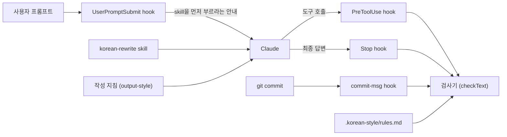

# 동작 원리

README에서 다루지 않는 내부 동작을 설명합니다.

이 도구는 Claude가 한국어를 쓰기 전과 쓴 뒤에 모두 개입합니다. 쓰기 전에는 `korean-rewrite` skill이 글을 다듬는 절차를 알려 주고, 쓴 뒤에는 검사기가 결과를 프로젝트 규칙과 대조합니다. hook은 그 사이에서 skill을 건너뛰지 못하게 하고, 검사기가 찾은 오류를 막습니다.
검사기는 규칙 문서에 적힌 목록과 한도에 따라 글을 검사하는 Node.js 프로그램입니다. 모델을 호출하거나 네트워크에 접속하지 않으므로 같은 글과 같은 규칙에는 항상 같은 결과를 냅니다.

## skill을 건너뛰지 못하게 하는 방식

사용자가 프롬프트를 보낼 때마다 UserPromptSubmit hook(`userprompt.mjs`)이 그 프롬프트에 안내를 덧붙여 Claude에게 전합니다. 한국어를 쓰기 전에 Skill 도구로 `korean-rewrite` skill을 먼저 부르라는 내용입니다.

Claude가 그 turn에서 skill을 부르지 않은 채 한국어를 쓰려 하면 다음 hook이 막습니다. skill은 한글이 규칙 문서의 `writing-skill-min-hangul`개 이상 들어간 글에만 요구합니다.

| 시점 | 보는 글 | skill을 부르지 않았을 때 |
| --- | --- | --- |
| 파일 쓰기 직전(`Write`, `Edit`, `MultiEdit`, `NotebookEdit`) | 이번에 새로 쓰는 내용 | 쓰기를 막고 skill을 부른 뒤 다시 쓰라고 안내합니다 |
| 사용자에게 묻거나 계획을 올리거나 파일을 보내기 직전(`AskUserQuestion`, `ExitPlanMode`, `SendUserFile`) | `chat-tool-fields`에 적은 필드 | 도구 실행을 막습니다 |
| `git commit` 직전(`Bash`) | `-m`과 `--message=` 값 | 커밋을 막습니다 |
| 답변을 마칠 때(Stop) | 최종 답변 | skill을 부르고 답변을 다시 쓰라고 요청합니다 |

hook은 transcript에서 이번 turn을 찾아 Skill 도구 호출이 있는지 봅니다. turn은 사용자가 직접 보낸 마지막 메시지 뒤에서 시작합니다. 도구 결과와 skill 본문처럼 Claude Code가 사용자 메시지로 기록한 줄은 사용자가 직접 보낸 메시지로 보지 않습니다.
subagent가 도구를 부르면 Claude Code는 메인 세션의 transcript 경로를 넘깁니다. 그래서 hook은 `agent_id`로 `<세션 ID>/subagents/agent-<agent_id>.jsonl`을 찾아 그 subagent가 skill을 불렀는지 봅니다.

hook은 다음과 같을 때 skill을 요구하지 않습니다.

- `writing-skill`의 값이 비어 있거나 `.claude/skills/`에 그 skill이 없을 때
- transcript를 읽지 못할 때
- 같은 turn에서 이미 두 번 막았을 때

세 번째 조건은 Skill 도구를 쓸 수 없는 환경에서 Claude가 끝없이 막히지 않게 하려고 둔 것입니다.

## 작성 지침이 적용되는 방식

Claude Code는 세션을 시작할 때 `outputStyle`로 고른 파일을 system prompt에 넣습니다. 지침은 어투와 기본 원칙을 담고, 한국어를 쓰기 전에 `korean-rewrite` skill을 부르라고 지시합니다. 자세한 판단 기준과 예시는 skill에 있습니다.
지침의 frontmatter에 `keep-coding-instructions: true`가 있어서 Claude Code의 기본 코딩 지침도 함께 적용됩니다.
설치 스크립트는 지침과 skill에서 `register:begin` 주석과 `register:end` 주석 사이를 고른 어투의 문구로 바꿉니다. 어투별 문구는 `skill/korean-style/register/`에 있습니다.
어투는 `--register`로 고르고, 생략하면 기존 규칙의 어투를 씁니다. 처음 설치할 때 생략하면 다나까체입니다.

## 검사 순서

모든 검사는 `scripts/lib/check.mjs`의 `checkText`를 거칩니다. hook과 CLI는 글마다 `chat`, `doc`, `comment`, `commit` 가운데 한 종류를 정해 이 함수에 넘깁니다.
종류에 따라 적용하는 규칙이 다릅니다. `checkText`는 받은 글을 다음 순서로 처리합니다.

1. **정규화:** 자모가 분리된 채 들어온 한글을 완성형 음절로 합칩니다(NFC).
2. **주석 추출:** 종류가 `comment`이면 확장자별 주석 문법(`//`, `/* */`, `#`, `--`, Python docstring)으로 주석만 남기고 문자열 리터럴은 지웁니다. 한글이 든 줄만 남긴 뒤 `doc`으로 검사합니다.
3. **코드 제외:** fenced code block과 inline code를 같은 길이의 공백으로 바꿉니다. 줄 수가 그대로여서 보고하는 줄 번호가 원문과 일치합니다.
4. **규칙 실행:** `scripts/lib/rules/`의 규칙 모듈 일곱 개를 차례로 실행해 위반을 모읍니다.
5. **code block 검사:** code block 안쪽은 따로 꺼내 일부 규칙으로만 검사합니다. 금지 문자(emoji 제외)와 어투, 호칭, 표기(외래어, 음차, 팀 용어), 오타 규칙을 적용하고 수량 표현 뒤에 쓴 복수 접미사와 차별 소지가 있는 용어도 봅니다. 규칙 설정 블록(`korean-style-rules`)은 제외합니다.
6. **등급 분류:** `advisory-rules`에 든 규칙의 위반은 경고로, 나머지는 오류로 분류합니다. hook은 오류만 막습니다.

| 종류 | 검사하는 글 | 적용하는 규칙 |
| --- | --- | --- |
| `chat` | 최종 답변, 사용자에게 묻는 질문, 승인받을 계획, 사용자에게 보내는 파일 설명 | 공통 규칙에 더해 명령, 호칭, 칭찬, 영어 답변, 팀 용어 표기 규칙 |
| `doc` | Markdown 문서, subagent 프롬프트 | 공통 규칙 |
| `comment` | 소스 파일의 주석 | 공통 규칙 |
| `commit` | 커밋 메시지 | 공통 규칙 |

파일의 종류는 경로로 정합니다. `skip-globs`에 맞는 경로는 검사하지 않고, `doc-globs`와 `source-globs`를 확장자보다 먼저 봅니다.
그다음 `.md`, `.mdx`, `.markdown`은 `doc`으로, 지원하는 소스 확장자는 `comment`로 정하고 나머지 파일은 검사하지 않습니다.

## 규칙 모듈

| 모듈 | 보는 것 | 기본 등급 |
| --- | --- | --- |
| `chars.mjs` | middle dot, em-dash, en-dash, emoji, 한자, 일본어 가나, 전각 괄호 | 오류 |
| `register.mjs` | 선택한 어투와 다른 종결어미, 사람에게 내리는 명령, 금지 호칭, 질문이나 지적을 칭찬하는 표현, 영어로만 쓴 답변 | 오류(영어 답변은 경고) |
| `punctuation.mjs` | 쉼표 수, 쉼표 구간 길이, 접속부사와 연결어미 뒤 쉼표 | 경고 |
| `structure.mjs` | 이중피동, 긴 문장, 수량 표현 뒤 복수 접미사, 명사형 종결과 지시 표현, `~적`, `~의`의 빈도 | 이중피동은 오류, 나머지는 경고 |
| `translationese.mjs` | 영어식 구절, 영어 동사를 직역한 동사 | 경고 |
| `vocabulary.mjs` | 외래어 표기, 오타, 한글 음차, 팀 용어 표기, 설명 없이 쓴 용어, 차별 소지가 있는 용어, 영어 낱말에 한글 부정 접두사를 붙인 표현 | 오류(차별 소지 용어와 부정 접두사 표현은 경고) |
| `density.mjs` | 조사가 붙은 영어 낱말, 같은 용어의 반복 설명, 굵은 글씨, 대조 구문의 빈도 | 경고 |

`banned-transliteration`, `banned-translation`, `required-spelling`, `needs-gloss`는 기본값이 비어 있고 `max-bound-english-per-sentence`는 0입니다. 팀이 목록을 채우거나 한도를 0보다 크게 정하면 검사기가 그때부터 검사합니다.
어투, 명령, 호칭, 칭찬, 오타 규칙은 따옴표 안을 보지 않으므로 인용한 문장은 이 규칙들에 걸리지 않습니다.
문장 단위 규칙은 문단, 목록 항목, 표 칸을 따로 나눈 뒤 마침표, 물음표, 느낌표 뒤에서 문장을 자릅니다. 제목 줄과 부호만 늘어놓은 줄은 문장으로 세지 않습니다.
쉼표 수, 쉼표 구간 길이, 긴 문장 규칙은 한글 비율이 `sentence-min-hangul-ratio` 이상이고 종결어미나 물음표, 느낌표로 끝나는 조각만 한국어 문장으로 셉니다.
두 쉼표 규칙은 따옴표와 괄호 안, 숫자 사이의 쉼표를 세지 않습니다. 짧은 항목을 쉼표로 늘어놓은 문장은 두 규칙에 걸리지 않습니다.
빈도 규칙은 한글 1000자당 횟수로 밀도를 재고, 대조 구문만 공백을 뺀 전체 글자 수를 기준으로 삼습니다. 횟수가 `density-rule-floor`보다 적으면 보고하지 않고, 밀도가 `한도 × (1 + density-margin ÷ √횟수)`를 넘을 때만 보고합니다.
횟수가 적을수록 여유가 커지므로 적게 나온 표현은 밀도가 한도를 크게 넘어야 걸립니다.
오류와 경고를 나눈 근거는 [검사 규칙](rules.md)에 있습니다.

## hook이 검사하는 부분

Claude Code는 도구를 실행하기 직전에 도구 이름과 입력을 JSON으로 `pretooluse.mjs`에 넘깁니다. hook은 `Task`와 `Agent`가 아니면 skill을 불렀는지 먼저 본 뒤 도구에 따라 다음 부분을 검사합니다.

| 도구 | 검사하는 부분 | 종류 |
| --- | --- | --- |
| `Write`, `Edit`, `MultiEdit` | 편집을 적용한 뒤의 파일 전체 | 경로로 정합니다 |
| `NotebookEdit` | 새로 쓰는 셀 내용(`new_source`) | 경로로 정합니다 |
| `AskUserQuestion`, `ExitPlanMode`, `SendUserFile` | `chat-tool-fields`에 적은 필드 | `chat` |
| `Task`, `Agent` | `agent-tool-fields`에 적은 필드 | `doc` |
| `Bash` | `git commit` 명령의 `-m`과 `--message=` 값 | `commit` |

`Edit`와 `MultiEdit`이면 hook은 현재 파일에 바꿀 내용을 적용한 결과를 만들어 파일 전체를 검사합니다. 그래서 이번에 고치지 않은 부분의 오류도 함께 보고합니다.
파일을 읽지 못하거나 바꿀 문자열을 찾지 못하면 새 문자열만 검사합니다. `.ipynb`는 기본 규칙에서 검사 대상이 아니므로 `doc-globs`에 넣어야 검사합니다.
`Bash` 명령이 `>`, `>>`, `tee`, `sed -i`, `perl -i`로 검사 대상 파일에 쓰려 하면 hook은 쓸 내용을 미리 알 수 없으므로 명령을 막고 Write나 Edit 도구로 다시 쓰라고 안내합니다.
오류가 있으면 hook은 `permissionDecision: deny`와 위반 목록을 돌려줍니다. Claude는 이 목록을 도구 실행 결과로 받아 문장을 고친 뒤 다시 시도합니다.

파일 쓰기에 오류가 없으면 hook은 바뀌기 전 파일과 바뀐 뒤 파일에서 산문만 남깁니다. 주석 밖의 코드와 code block을 파일 전체에서 공백으로 가리므로, 고친 부분에 주석 표시나 fence가 없어도 주석 안의 글은 검사하고 code block 안의 글은 건너뜁니다.
그다음 앞뒤로 같은 줄을 빼고 바뀐 줄이 든 문단만 양쪽에서 검사해 비교합니다. NotebookEdit 도구로 셀을 고칠 때는 바뀌기 전 셀과 비교하지 않으므로 원래 있던 경고도 알립니다.
`review-rules`에 든 규칙의 경고가 바뀐 뒤 문단에만 있으면 `additionalContext`로 최대 다섯 건을 돌려줍니다. 줄 번호는 파일 기준이고, NotebookEdit 도구로 고친 셀에서는 셀 안의 줄 번호입니다. 어색하면 고치고 문맥에 맞으면 그대로 두라는 안내도 함께 붙습니다.
이때 hook은 권한 결정을 내리지 않으므로 사용자 승인 절차는 그대로입니다. Claude는 이 목록을 도구 결과와 함께 받습니다.

Claude Code가 답변을 마치면 `stop.mjs`가 마지막 답변(`last_assistant_message`)을 `chat`으로 검사합니다. 이 값을 주지 않는 구버전에서는 transcript에서 이번 turn의 답변을 모읍니다.
skill을 부르지 않았거나 오류가 있으면 `decision: block`과 그 이유를 돌려줍니다. Claude는 내용을 유지한 채 답변을 다시 씁니다.
답변을 다시 쓴 뒤 hook이 실행될 때는 `stop_hook_active`가 켜져 있으므로 검사하지 않고 끝납니다. 그래서 재작성은 한 번만 요청합니다.

설치 스크립트는 `git rev-parse --git-path hooks/commit-msg`가 가리키는 경로에 작은 Node.js 실행기 파일을 만듭니다.
실행기는 커밋하는 checkout의 루트를 찾아 그 안의 `.korean-style/scripts/hooks/commit-msg.mjs`를 실행합니다. 이 스크립트는 `#`으로 시작하는 줄을 뺀 메시지를 `commit`으로 검사하고, 오류가 있으면 종료 코드 1로 커밋을 멈춥니다.

hook은 실행될 때마다 규칙 문서를 새로 읽습니다. 규칙을 고치면 Claude Code를 다시 시작하지 않아도 다음 검사부터 반영됩니다.

## 규칙 문서를 읽는 방식

검사기는 `.korean-style/rules.md`의 `korean-style-rules` code block에서만 설정을 읽습니다. 블록 밖의 설명은 검사에 쓰지 않고 `--explain`으로 보여 줄 때만 읽습니다.
블록의 각 줄은 `키: 값` 형식이고 `#`으로 시작하는 줄은 주석입니다. 목록은 쉼표로 나누고, 치환 후보는 `원문=후보`로, 도구 필드는 `도구.필드`로 적습니다.
규칙 문서를 열지 못하거나 블록이 없으면 CLI는 실패합니다. hook은 멈추지 않고 검사를 이어 가지만, 이때 검사하는 것은 금지 문자, 금지 호칭, 영어로만 쓴 답변뿐입니다. hook은 기본값대로 `korean-rewrite` skill도 요구합니다.

## 재설치할 때 직접 고친 규칙을 보존하는 방식

설치 스크립트는 기본 규칙 문서에서 `register:` 줄의 값만 비우고 SHA-256 값을 구해 `.korean-style/defaults.sha256`에 적습니다.
다시 설치할 때 현재 `rules.md`에서 같은 방식으로 구한 값이 저장된 값이나 새 기본 규칙에서 구한 값과 같으면 규칙을 고치지 않은 것으로 보고 새 기본값으로 바꿉니다.
값이 다르면 직접 고친 규칙으로 보고 그대로 둡니다. `register:` 줄은 비교에서 빼므로 `--register`로 어투만 바꾼 규칙은 고치지 않은 규칙으로 봅니다.
`.claude/settings.json`에서는 명령에 `.korean-style/scripts/hooks/` 아래의 `userprompt.mjs`, `pretooluse.mjs`, `stop.mjs`가 든 hook만 이 도구의 것으로 보고 교체합니다. 다른 hook 항목은 그대로 둡니다.
